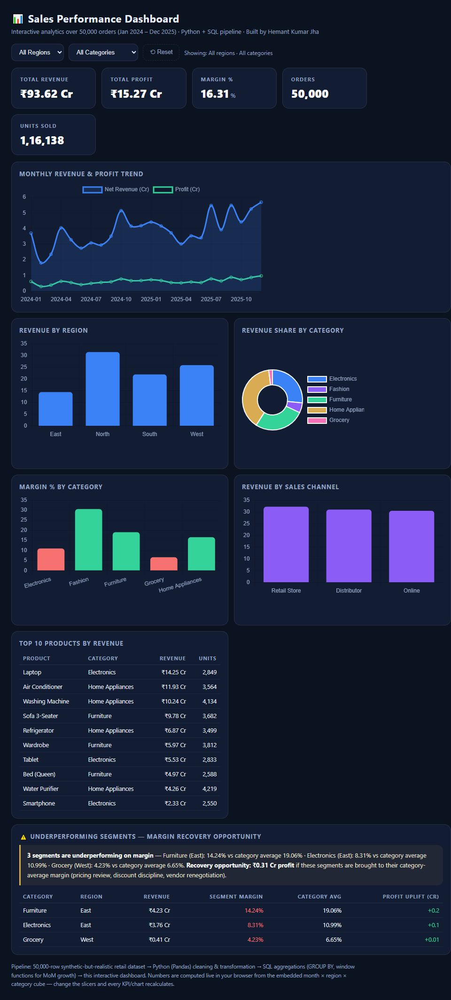

**Live Dashboard:** https://hemantkjha-data.github.io/sales-performance-dashboard/dashboard/

# 📊 Sales Performance Dashboard

**Business question:** *Where is revenue coming from, which segments are dragging margin down, and what is the recovery worth?*



**Live dashboard → open `dashboard/index.html` in any browser.** Change the Region/Category slicers and every KPI, chart and the insight panel recompute live from an embedded month × region × category cube.

## ▸ Project Highlights

▸
Built an end-to-end pipeline — ingest, clean and validate 50,000 rows of raw sales data (Python/Pandas), load into SQLite with indexes, aggregate in SQL.
▸
Analysed ₹93.62 Cr revenue across 4 regions, 5 categories, 3 sales channels and 24 months — 1,16,138 units at a 16.31% blended margin.
▸
Identified 3 underperforming segments via a category × region margin heatmap — Furniture-East (14.24% vs 19.06% category avg), Electronics-East (8.31% vs 10.99%) and Grocery-West (4.23% vs 6.65%).
▸
Simulated the recovery — lifting those 3 segments to their category-average margin is worth **+₹0.31 Cr profit**, quantified with a margin-gap SQL model and surfaced directly in the dashboard.

## 📁 Repo Structure

```
├── data/
│   ├── sales_data.csv    # 50,000 raw orders (synthetic, deterministic)
│   └── sales_data.db     # SQLite database built by the pipeline
├── sql/
│   └── queries.sql       # 10 annotated analytical queries (incl. window functions)
├── pipeline.py           # extract → clean → validate → load → aggregate
└── dashboard/
    ├── index.html        # Interactive dashboard (Chart.js, live slicer recompute)
    ├── agg_data.json     # Pipeline output consumed by the dashboard
    └── screenshot.jpg
```

## 🚀 How to Run

```bash
pip install pandas
python pipeline.py          # rebuilds the DB + aggregates
# then open dashboard/index.html
```

No Python needed to *view* the dashboard — it works standalone in the browser.

## 🔍 Key SQL (margin-recovery model)

```sql
WITH seg AS (
  SELECT category, region,
         SUM(net_revenue) rev,
         100.0*SUM(profit)/SUM(net_revenue) seg_margin
  FROM sales GROUP BY category, region
), catavg AS (
  SELECT category, 100.0*SUM(profit)/SUM(net_revenue) cat_margin
  FROM sales GROUP BY category
)
SELECT s.category, s.region,
       ROUND(s.rev/10000000.0,2) revenue_cr,
       ROUND(s.seg_margin,2) segment_margin_pct,
       ROUND(c.cat_margin,2) category_avg_pct,
       ROUND((c.cat_margin - s.seg_margin)/100 * s.rev/10000000.0, 2) profit_uplift_cr
FROM seg s JOIN catavg c ON s.category = c.category
ORDER BY (c.cat_margin - s.seg_margin) DESC LIMIT 5;
```

## 💡 Analytical Takeaways

1. **Growth is real but uneven** — steady monthly momentum, yet East under-indexes in high-value categories (Furniture, Electronics), suggesting a mix problem, not a demand problem.
2. **Margin weakness is segment-local, not company-wide** — Electronics-East at 8.31% vs 10.99% category-wide points to regional pricing/discount discipline, not product economics.
3. **Discounting has a measurable cost** — the Discounted vs Full-price cohort comparison quantifies exactly what promotional intensity buys and what it erodes.
4. **A 0.31 Cr recovery needs no new revenue** — closing 3 segments to their own category average is a pricing-execution story, the cheapest profit in the book.

---

*Dataset is synthetic and generated deterministically for portfolio demonstration. All figures are computed from the data via `pipeline.py` and `sql/queries.sql`.*

**Built by Hemant Kumar Jha** · Data Analyst · SQL · Python · Dashboards
